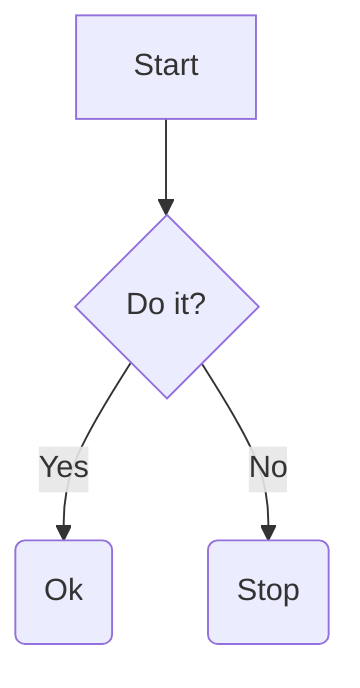

# Collapsible Codeblock

less than line count limit

```cpp
#include<iostream>

using namespace std;

int main()
{
    cout<<"Hello World";
    return 0;
}
```

equals line count limit

```cpp
// @file main.cpp
#include<iostream>

using namespace std;

int main()
{
    cout<<"Hello World";
    return 0;
}
```

codeblock with preview




